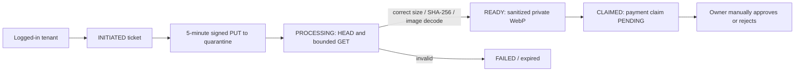

# P3 S3-compatible Signed Upload — Operations & Threat Model

Status: **Implemented with local HTTP S3 mock integration; real provider E2E not yet verified. DEV only.**
Code: `apps/api/src/services/evidence-s3.ts`, `src/routes/evidence-uploads.ts`, React `TenantPayments.tsx`, Drizzle migration `0005`.

## Upload state machine

Steps:
1. Backend verifies active session, linked active tenant lease, issued invoice, and enabled payment instructions.
2. Client computes SHA-256 of source bytes and requests `POST /v1/tenant/invoices/:invoiceId/payment-uploads/initiate` with image MIME, byte count, base64 digest. A DB ticket is scoped to user/org/property/invoice and expires in five minutes.
3. Backend signs a **PUT-only** URL for `quarantine/v1/<org-uuid>/<ticket-uuid>`, with checksum and exact content length. URL must never be logged or shared outside the owning client.
4. Browser PUTs directly to the storage endpoint using only signed headers, *not* app cookies. Private bucket must be configured for CORS with the production web origin only.
5. Client calls `POST /v1/tenant/invoices/:invoiceId/payment-uploads/:uploadId/finalize`. Backend validates metadata with HEAD, streams at most 4MB+1, verifies actual checksum and exact byte count, decodes image (max 12 megapixels) and creates sanitized metadata-free WebP as `private/evidence/v1/<uuid>.webp`. Original quarantined object is deleted (also covered by bucket lifecycle).
6. Finalize changes ticket to READY. Client sends `POST /v1/tenant/invoices/:invoiceId/payment-claims/from-upload` with `uploadId`, amount in integer satang, transfer time and optional reference, and an idempotency key. Claim and READY→CLAIMED ticket update occur in the **same PostgreSQL transaction**, with invoice/ticket row locking. A ticket cannot be attached twice.
7. Owner sees private file through a **backend-authorized** GET endpoint. No public URLs / S3 GET presigning. Bank verification is **not implemented**; claims stay PENDING until owner reviews.

## Required ENV (when provider is chosen)

`EVIDENCE_STORAGE_DRIVER=s3`, `EVIDENCE_S3_BUCKET`, `EVIDENCE_S3_REGION`, `EVIDENCE_S3_ACCESS_KEY_ID`, `EVIDENCE_S3_SECRET_ACCESS_KEY`. Optional: `EVIDENCE_S3_ENDPOINT` (for S3-compatible vendor), `EVIDENCE_S3_FORCE_PATH_STYLE=true` (for path-style vendor).

Security: endpoint must be HTTPS. Plain `http://127.0.0.1` or `http://localhost` is accepted **only when NODE_ENV=development** for localhost mock tests. Production launch is still blocked by API config guard.

Minimum IAM allow actions on the specified private bucket prefixes:
- PutObject quarantine/v1/*
- HeadObject + GetObject quarantine/v1/*
- DeleteObject quarantine/v1/*
- PutObject + HeadObject + GetObject private/evidence/v1/*
- DeleteObject private/evidence/v1/* for explicit failed-transaction/retention cleanup

Never grant wildcard public bucket listing or GetObject to anonymous users. Use restrictive IAM role/service credentials and bucket-level encryption policy. Prefer managed secret storage and scheduled credential rotation.

Provider CORS minimum: AllowedOrigins = [real HTTPS WEB_ORIGIN]; AllowedMethods = [PUT]; AllowedHeaders = [content-type,content-length,x-amz-checksum-sha256,x-amz-meta-upload-id]; MaxAgeSeconds <= 300. CORS changes vary by provider and must be tested in a real browser. **CORS is not authentication**; protect bucket by IAM/policy and presigned scope.

Bucket lifecycle:
- Delete `quarantine/v1/*` after 1 day (5-min URLs; clean up even after crashed finalize).
- Do NOT expire `private/evidence/v1/*` without documented retention, user deletion / legal hold / financial audit policy.
- Expired READY ticket objects are unclaimed and should be garbage-collected with DB reference reconciliation (worker still pending).

## Verified vs blocked

- [x] 5-minute signed quarantine PUT code with content-length and checksum in signature.
- [x] Backend HEAD / bounded GET / SHA-256 verification / pixel decode and WebP reencode.
- [x] Atomic ticket lifecycle and single-consumption constraint.
- [x] Real PostgreSQL + live local HTTP S3 mock integration with positive/negative authorization, bad checksum, replay, private-only evidence.
- [x] Existing DEV local multipart upload unaffected.
- [ ] S3 provider / MinIO test with real signature validation and bucket policy.
- [ ] Browser CORS E2E on actual HTTPS domain / LINE LIFF.
- [ ] Malware scanning, file retention/deletion policy, lifecycle proof, restore drill and orphan cleanup worker.
- [ ] Production security/performance signoff; API rejects NODE_ENV=production.

Test: `corepack pnpm --filter @apartment/api smoke:s3`. This uses its own in-memory HTTP mock on 127.0.0.1:59000. It does NOT verify provider IAM/SigV4 validation.

## P3-02b.6 DEV retention and scanner
See docs/P3_EVIDENCE_RETENTION_MALWARE.md for manual dry-run-first cleanup, legal-hold rules, ClamAV protocol, and remaining production gates. No production cleanup scheduling or real provider validation completed.
